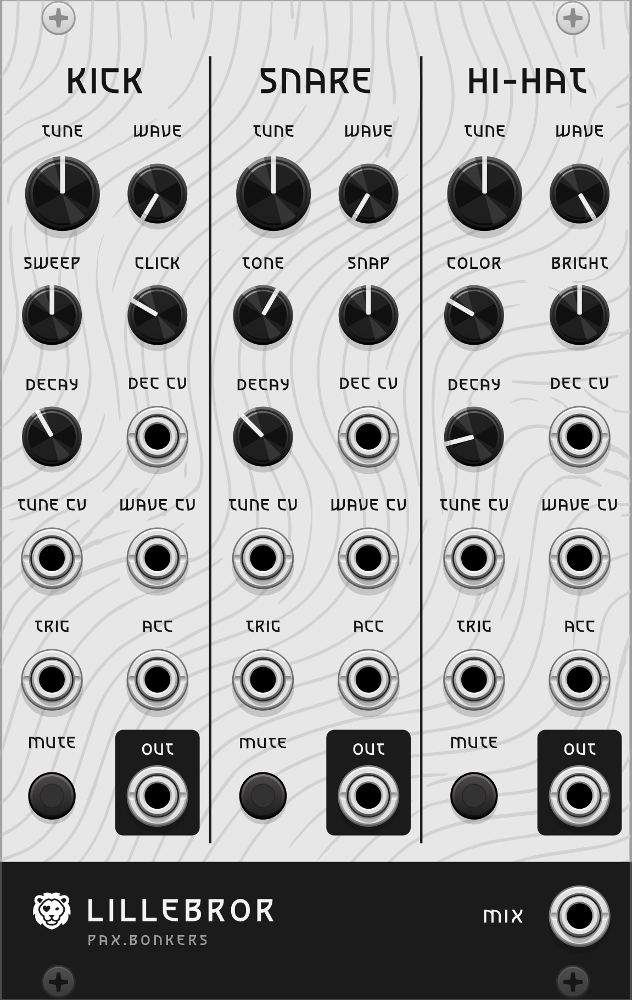

# PaxBonkers – VCV Rack plugin

Modules for [VCV Rack 2](https://vcvrack.com) by [pax.bonkers](https://www.instagram.com/pax.bonkers/).

| Module | |
|---|---|
| [Escarpo](#escarpo) | Clock swing, drift & burst · 8 HP |
| [Lillebror](#lillebror) | Three drum voices, the little brother of Grids · 16 HP |

## Escarpo

<p align="center">
  
</p>

*Clock swing, drift & burst.*
Named after Jean-Honoré Fragonard's painting *L'Escarpolette* (*The Happy Accidents of the Swing*, 1767).

Escarpo delays every incoming clock pulse by a fraction of the measured clock period and can turn each pulse into a burst (ratchet). Patch an LFO or random CV into the delay input and the clock starts to drift, breathe and swing against the original.

8 HP, monophonic.

### Controls

| Control | Range | Function |
|---|---|---|
| **DELAY** | 0–90 % of the clock period | Delay applied to every clock pulse |
| **ATTEN** | −100 … +100 % | Amount and polarity of the delay CV |
| **BURST** | 1–8 (stepped) | Pulses per incoming clock pulse; 1 = off |

### Inputs and outputs

| Port | Description |
|---|---|
| **CLOCK** | Clock / gate input. High at ≥ 1 V, low at ≤ 0.1 V |
| **RESET** | Clears pending pulses and forgets the measured tempo |
| **CV** (delay) | Added to DELAY via ATTEN. 1 V = 10 % of the period |
| **CV** (burst) | Added to BURST. 1 V = 1 step |
| **THRU** | Unmodified clock input |
| **OUT** | Delayed clock / burst, 0 V / 10 V. The LED shows this output |

### Behaviour

- **Tempo** is measured from the last two rising clock edges. The first pulse after start or reset passes through undelayed and without burst.
- **Delay and burst are sampled once per pulse**, when the pulse arrives. Modulation never shifts a pulse that is already on its way.
- **Burst = 1:** the gate length of the input is preserved.
- **Burst > 1:** N pulses are spread evenly across one clock period, starting at the delayed time. Each pulse is half the burst interval long.
- **Pulses never overtake each other.** If the next clock arrives before a delayed pulse was sent, that pulse is fired immediately as a short trigger. A running burst is cut off by the next clock.
- **Pauses:** a gap longer than 4× the known period is treated as a restart, not as a new tempo, so the first pulse after stopping a sequencer is not delayed for seconds.
- **Bypass** sends the clock to both THRU and OUT.

### Context menu

- **Quantize delay:** snaps the total delay (knob + CV) to musical subdivisions of the period: 0, 1/6, 1/4, 1/3, 1/2, 2/3, 3/4. With an LFO or random CV on the delay input, the timing jumps between musically related positions. Saved with the patch.

### Patch ideas

- Kick on **THRU**, hi-hat on **OUT**, DELAY at a few percent: laid-back hats.
- Slow sine LFO into delay CV, ATTEN at ~30 %: a groove that breathes.
- Random S&H into delay CV with *Quantize delay* on: shifting but always "on grid" offbeats.
- Square LFO into burst CV: alternating single hits and ratchets.

## Lillebror

<p align="center">
  
</p>

*Three drum voices – the little brother of Grids.*

16 HP, monophonic.

### The concept: a little brother

*Lillebror* is Swedish for "little brother". The idea comes from Astrid Lindgren's *Bröderna Lejonhjärta* (*The Brothers Lionheart*): two brothers who only make sense together.

Here, the big brother is **Mutable Instruments Grids**. In VCV Rack it is available as Valley's [*Topograph*](https://library.vcvrack.com/Valley/Topograph), for example. Grids is a rhythm generator: it moves through a map of drum patterns and sends out triggers and accents for kick, snare and hi-hat, but it makes no sound itself.

Lillebror is the other half. It turns exactly these six signals into sound. Its three columns match the three Grids channels, so you patch them 1:1:

| Grids / Topograph | → | Lillebror |
|---|---|---|
| Trig 1 / BD | → | KICK · TRIG |
| Trig 2 / SD | → | SNARE · TRIG |
| Trig 3 / HH | → | HI-HAT · TRIG |
| Acc 1 / 2 / 3 | → | ACC of the same column |

The lion next to the name is a nod to the Lionhearts. The big brother may get his own module later.

The sound is loosely inspired by percussion synths such as ALM's *Tyso Daiko*: a waveform morph instead of a fixed sine, and accents that change the character of a hit, not just its level.

### Voices and controls

| | KICK | SNARE | HI-HAT |
|---|---|---|---|
| **TUNE** | 19–155 Hz (default 55 Hz) | 64–509 Hz (default 180 Hz) | cluster base 141–1131 Hz (default 400 Hz) |
| **WAVE** | sine → triangle → saw → square | sine → triangle → saw → square (body) | waveform of the six cluster oscillators |
| 2nd row left | **SWEEP**: pitch drop at the start, up to 4 octaves | **TONE**: body ↔ noise | **COLOR**: metallic cluster ↔ noise |
| 2nd row right | **CLICK**: short noise click | **SNAP**: short noise burst | **BRIGHT**: high-pass 400 Hz – 7 kHz |
| **DECAY** | 30 ms – 2 s | 30 ms – 1 s | 10 ms – 1.5 s |

Decay is the time to fall by 60 dB.

- **Kick:** a morphing oscillator with a fast exponential pitch sweep. With WAVE at sine it is a classic electronic kick. Towards saw and square it becomes a buzzing bass drum or a zap.
- **Snare:** a morphing body tone with a short pitch drop, plus band-passed noise (1.2–9 kHz) and a snap burst. The body decays faster than the noise, as on a real snare.
- **Hi-hat:** six oscillators at the inharmonic ratios of the classic 808 hi-hat, mixed with noise and sent through a high-pass. WAVE changes the oscillators from square (hard, metallic) to sine (soft, bell-like).

### Inputs, outputs and buttons

| Port | Description |
|---|---|
| **TRIG** | Trigger. Rising edge at ≥ 1 V (released at ≤ 0.1 V) |
| **ACC** | Accent. Counts if high (≥ 1 V) at the trigger or up to 1 ms after it |
| **TUNE CV** | Added to TUNE, 1 V/oct. Knob + CV is limited to ±3 octaves |
| **WAVE CV** | Added to WAVE, 1 V = 10 % |
| **DEC CV** | Added to DECAY, 1 V = 10 % |
| **MUTE** | Latching button; the red light shows a muted voice |
| **OUT** | Voice output, about ±5 V for a normal hit |
| **MIX** | Sum of the three voices × 0.6. Muted voices are left out |

### Accent

An accented hit is +6 dB louder, and each voice reacts in its own way:

- **Kick:** decay × 1.5, longer and fuller
- **Snare:** decay × 0.7 and snap × 1.5, shorter and snappier
- **Hi-hat:** decay × 2, more "open"

With Grids this means accents shape the groove, not just the volume.

### Behaviour and technical notes

- **Monophonic.** Only the first channel of each input is used, and all outputs are mono.
- **Triggers and accents.** A trigger reads its column's ACC input. An accent that arrives up to 1 ms after the trigger still counts, so small timing differences between cables do not matter.
- **Retriggering.** A new hit restarts the envelope with a 0.5 ms attack from its current level. Kick and snare also reset their oscillator phase for a consistent attack.
- **CV inputs** are read continuously. WAVE CV can therefore morph the waveform during a hit, and DEC CV can lengthen or shorten a hit that is already sounding. Invalid voltages (NaN/Inf) are ignored.
- **Mute** fades the voice out and in over 5 ms, so it does not click. The voice keeps running internally. The mute state is saved with the patch.
- **Levels.** Outputs are not clipped. Extreme settings can produce peaks above ±5 V, and accents above ±10 V.
- **Aliasing.** Saw and square are band-limited with PolyBLEP. The triangle is calculated directly, because its soft corners produce very little aliasing.
- **Sample rate.** All times and filters are derived from the current sample rate. Noise is level-compensated, so the voices sound the same at 44.1 kHz and 192 kHz.
- **Real-time safe.** The audio thread does no memory allocation, I/O or locking.
- **Bypass** silences all outputs.

### Patch ideas

- **Classic:** Topograph into Lillebror, MIX into Audio, then explore the map with Map X / Map Y.
- **Breathing hats:** a slow LFO into HI-HAT · WAVE CV moves the hats between metallic and soft.
- **Bass line:** a sequencer's pitch CV into KICK · TUNE CV and its gate into KICK · TRIG, with WAVE towards saw and a long DECAY.
- **Accent drama:** turn the Grids accent density up and listen to the kick swell and the hats open.

### Known limits

- With WAVE at sine and BRIGHT fully up, the hi-hat is almost silent, because the high-pass removes the low sine cluster.
- At the default settings the hi-hat is quieter than kick and snare.

## Building

Requires the [VCV Rack SDK](https://vcvrack.com/manual/PluginDevelopmentTutorial) 2.x.

```sh
export RACK_DIR=/path/to/Rack-SDK   # defaults to ../Rack-SDK
make
make install
```

Unit tests (no Rack needed):

```sh
mkdir -p build
c++ -std=c++11 -Isrc tests/test_swingcore.cpp -o build/test_swingcore && ./build/test_swingcore
c++ -std=c++11 -O2 -Isrc tests/test_lillebror.cpp -o build/test_lillebror && ./build/test_lillebror
```

## License

Source code and panels: © [pax.bonkers](https://www.instagram.com/pax.bonkers/), licensed under the [GNU General Public License v3.0 or later](LICENSE).

The Lillebror panel lettering uses outlines of the font Asimovian by Carolina Short (© The Asimovian Project Authors, SIL Open Font License 1.1, see [res/Asimovian-OFL.txt](res/Asimovian-OFL.txt)).

Knobs, jacks, buttons, screws and lights are drawn by VCV Rack's built-in Component Library (© VCV, CC BY-NC 4.0); their graphics are loaded from the Rack installation and are not part of this repository.

Mutable Instruments and Grids are names of their respective owners. Lillebror is an independent project and contains no code from Grids.
