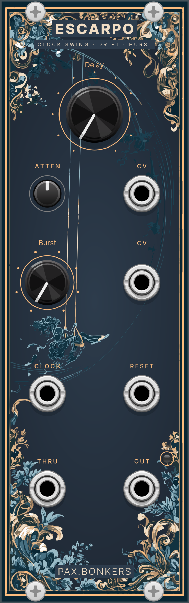

# Escarpo – VCV Rack plugin

Modules for [VCV Rack 2](https://vcvrack.com) by pax.bonkers.

## Escarpo



*Clock swing, drift & burst.*
Named after Jean-Honoré Fragonard's painting *L'Escarpolette* (*The Happy Accidents of the Swing*, 1767).

Escarpo delays every incoming clock pulse by a fraction of the measured clock period and can turn each pulse into a burst (ratchet). Patch an LFO or random CV into the delay input and the clock starts to drift, breathe and swing against the original.

8 HP, monophonic.

### Controls

| Control | Range | Function |
|---|---|---|
| **DELAY** | 0–90 % of the clock period | Delay applied to every clock pulse |
| **ATTEN** | −100 … +100 % | Amount and polarity of the delay CV |
| **BURST** | 1–8 (stepped) | Pulses per incoming clock pulse; 1 = off |

### Inputs and outputs

| Port | Description |
|---|---|
| **CLOCK** | Clock / gate input. High at ≥ 1 V, low at ≤ 0.1 V |
| **RESET** | Clears pending pulses and forgets the measured tempo |
| **CV** (delay) | Added to DELAY via ATTEN. 1 V = 10 % of the period |
| **CV** (burst) | Added to BURST. 1 V = 1 step |
| **THRU** | Unmodified clock input |
| **OUT** | Delayed clock / burst, 0 V / 10 V. The LED shows this output |

### Behaviour

- **Tempo** is measured from the last two rising clock edges. The first pulse after start or reset passes through undelayed and without burst.
- **Delay and burst are sampled once per pulse**, when the pulse arrives. Modulation never shifts a pulse that is already on its way.
- **Burst = 1:** the gate length of the input is preserved.
- **Burst > 1:** N pulses are spread evenly across one clock period, starting at the delayed time. Each pulse is half the burst interval long.
- **Pulses never overtake each other.** If the next clock arrives before a delayed pulse was sent, that pulse is fired immediately as a short trigger. A running burst is cut off by the next clock.
- **Pauses:** a gap longer than 4× the known period is treated as a restart, not as a new tempo, so the first pulse after stopping a sequencer is not delayed for seconds.
- **Bypass** sends the clock to both THRU and OUT.

### Context menu

- **Quantize delay:** snaps the total delay (knob + CV) to musical subdivisions of the period: 0, 1/6, 1/4, 1/3, 1/2, 2/3, 3/4. With an LFO or random CV on the delay input, the timing jumps between musically related positions. Saved with the patch.

### Patch ideas

- Kick on **THRU**, hi-hat on **OUT**, DELAY at a few percent: laid-back hats.
- Slow sine LFO into delay CV, ATTEN at ~30 %: a groove that breathes.
- Random S&H into delay CV with *Quantize delay* on: shifting but always "on grid" offbeats.
- Square LFO into burst CV: alternating single hits and ratchets.

## Building

Requires the [VCV Rack SDK](https://vcvrack.com/manual/PluginDevelopmentTutorial) 2.x.

```sh
export RACK_DIR=/path/to/Rack-SDK   # defaults to ../Rack-SDK
make
make install
```

Unit tests for the timing core (no Rack needed):

```sh
mkdir -p build
c++ -std=c++11 -Isrc tests/test_swingcore.cpp -o build/test_swingcore && ./build/test_swingcore
```

## License

Source code: © pax.bonkers, licensed under the [GNU General Public License v3.0 or later](LICENSE).

Knobs, jacks, screws and lights are drawn by VCV Rack's built-in Component Library (© VCV, CC BY-NC 4.0); their graphics are loaded from the Rack installation and are not part of this repository.
